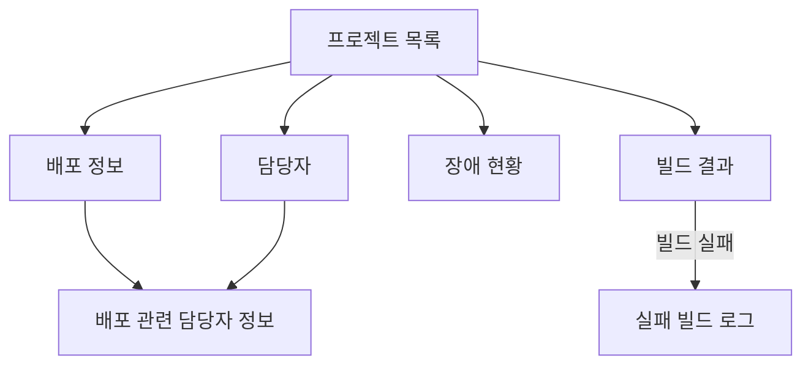

# React 비동기 처리 코딩 테스트 문제집

> React 컴포넌트에서 발생하는 비동기 상태·렌더링·생명주기 문제를 다룬다. 실제 서버 대신 응답 순서와 실패를 제어할 수 있는 Mock API를 사용한다. 이 문서에는 **문제와 구현 요구사항만** 포함하며 정답과 해설은 포함하지 않는다.

## Level 1. 비동기 UI 상태 관리 (중급)

### 문제 01. 검색어 변경과 컴포넌트 언마운트 — `useEffect` Race Condition

#### 상황

렌터카 검색 화면에서 사용자가 `SUV`를 입력한 뒤 즉시 `SUV 전기차`로 검색어를 변경한다. React 컴포넌트는 검색어 변경에 따라 비동기 검색을 실행한다.

두 번째 요청이 먼저 완료된 뒤 첫 번째 요청이 나중에 완료되면 오래된 검색 결과가 화면을 덮어쓸 수 있다. 사용자가 결과를 기다리는 중 페이지를 이동해 컴포넌트가 언마운트될 수도 있다.

다음과 같은 코드가 제공되어 있다고 가정한다.

```jsx
useEffect(() => {
  async function search() {
    const response = await fetch(`/api/cars?q=${query}`);
    const result = await response.json();
    setCars(result);
  }
  search();
}, [query]);
```

#### 구현 요구사항

1. 화면에는 현재 검색어에 해당하는 최신 결과만 표시한다.
2. 검색어가 변경되거나 컴포넌트가 언마운트되면 이전 작업을 취소하거나 무효화한다.
3. 이전 요청이 뒤늦게 실패해도 최신 검색의 오류 상태를 덮어쓰지 않는다.
4. 로딩 표시와 종료는 최신 검색 요청의 생명주기에 맞춰 동작해야 한다.
5. 검색어를 URL에 포함할 때 URI 인코딩을 적용한다.
6. HTTP 응답의 성공 여부를 확인하고 실패 응답을 오류 상태로 처리한다.
7. 언마운트 후에 완료된 비동기 작업이 컴포넌트의 화면 상태에 영향을 주지 않아야 한다.

**구현 대상:** `useCarSearch` 또는 검색 화면 컴포넌트

---

### 문제 02. 관리자 상품 목록의 필터·페이지 상태 일관성

#### 상황

쇼핑몰 관리자 페이지는 상품 카테고리, 판매 상태, 정렬 기준, 페이지 번호에 따라 상품 목록을 조회한다. 사용자가 빠르게 조건을 바꾸면 여러 검색 요청이 겹친다.

```text
A: 카테고리=의류, 페이지=1
B: 카테고리=의류, 페이지=2
C: 카테고리=전자제품, 페이지=1
```

C가 먼저 완료된 후 B가 늦게 응답하면 현재 필터와 맞지 않는 상품 목록이 나타날 수 있다. 상품 목록과 전체 상품 수가 서로 다른 요청에서 갱신될 위험도 있다.

#### 구현 요구사항

1. 현재 필터 및 페이지 조건에 해당하는 응답만 화면에 반영한다.
2. 상품 목록과 총 상품 수는 반드시 동일한 API 응답에서 가져온다.
3. 필터나 정렬 기준이 변경되면 페이지 번호를 1로 초기화한다.
4. 이전 요청의 실패가 현재 목록의 오류 상태에 영향을 주지 않아야 한다.
5. 요청 중에는 현재 조회 조건에 대한 로딩 상태를 표시한다.
6. 현재 조건을 유지한 채 새로고침하면 새로운 API 요청을 수행한다.
7. 컴포넌트 언마운트 시 진행 중인 작업의 결과가 화면에 반영되지 않아야 한다.

**구현 대상:** `useProductList` 및 상품 목록 컴포넌트

---

## Level 2. 비동기 작업과 UI 생명주기 (중상급)

### 문제 03. 다중 이미지 업로드 UI 관리자

#### 상황

판매자가 상품 이미지 20개를 선택해 업로드한다. 서버는 클라이언트당 동시 업로드 요청을 최대 3개로 제한한다. 파일마다 업로드 시간이 다르고, 네트워크 장애로 일부 파일이 실패할 수 있다.

화면에는 파일별 대기·업로드 중·성공·실패·취소 상태와 전체 진행 상황이 표시되어야 한다.

#### 구현 요구사항

1. 동시에 실행되는 실제 업로드 요청은 최대 3개다.
2. 실행 중인 업로드가 종료되면 대기 중인 다음 파일을 업로드한다.
3. 네트워크 오류로 실패한 파일은 최대 2회 추가 재시도한다.
4. 재시도 횟수를 초과한 파일은 실패 상태로 표시한다.
5. 특정 파일이 실패해도 다른 파일은 계속 업로드한다.
6. 사용자는 대기 중이거나 진행 중인 파일을 개별적으로 취소할 수 있다.
7. 이미 완료된 파일을 중복 업로드하지 않는다.
8. 파일별 진행률과 전체 업로드 현황이 실제 작업 상태와 일치해야 한다.
9. 컴포넌트 언마운트 후 완료되거나 실패한 요청은 화면 상태를 갱신하지 않아야 한다.

**구현 대상:** `useUploadManager` 및 업로드 목록 컴포넌트

---

### 문제 04. 택배 배송 상태 자동 갱신 화면

#### 상황

주문 상세 화면은 배송사 API를 주기적으로 호출해 배송 상태를 자동 갱신한다.

```text
READY
PICKED_UP
IN_TRANSIT
OUT_FOR_DELIVERY
DELIVERED
```

배송사 서버가 일시적으로 실패하거나 과도한 요청 오류를 반환할 수 있다. 사용자는 배송 상태를 확인하다가 다른 페이지로 이동할 수도 있다.

#### 구현 요구사항

1. 기본 조회 간격은 2초다.
2. 이전 API 요청이 완료되기 전에는 새로운 조회 요청을 중복 실행하지 않는다.
3. 일시적인 네트워크 오류나 서버 과부하 오류에 대해서는 재시도한다.
4. 연속 실패 횟수가 증가하면 다음 조회까지의 대기 시간을 늘린다.
5. 정상 응답을 받으면 기본 조회 간격으로 복귀한다.
6. 배송 상태가 `DELIVERED`가 되면 자동 조회를 중단한다.
7. 로딩·배송 상태·오류 정보를 화면에서 확인할 수 있어야 한다.
8. 사용자가 조회를 중지하거나 컴포넌트를 언마운트하면 예정된 타이머와 진행 중 요청을 정리한다.
9. 중단 이후 늦게 도착한 응답은 화면 상태를 변경하지 않아야 한다.

**구현 대상:** `useDeliveryPolling` 및 배송 상태 컴포넌트

---

## Level 3. 복잡한 UI 데이터 수집과 렌더링 (상급)

### 문제 05. 프로젝트 모니터링 대시보드

#### 상황

개발 조직의 운영 대시보드에는 접근 가능한 프로젝트 30개의 배포 정보, 빌드 결과, 장애 현황, 담당자 및 실패 빌드 로그가 표시된다.

프로젝트별 데이터는 서로 다른 API에서 제공되며 일부 요청은 실패할 수 있다. 사용자는 전체 데이터가 완료되기 전에도 조회된 프로젝트의 상태를 확인할 수 있어야 한다.

#### 요청 의존성



위 의존성은 각 프로젝트에 독립적으로 적용된다.

#### 구현 요구사항

1. 접근 가능한 프로젝트 목록을 받은 뒤 프로젝트별 상세 요청을 실행한다.
2. 서로 의존하지 않는 상세 요청은 병렬로 실행한다.
3. 전체 API 요청 중 동시 실행 수는 최대 5개다.
4. 빌드가 성공한 프로젝트에 대해서는 실패 빌드 로그를 조회하지 않는다.
5. 빌드 조회가 실패한 경우 해당 빌드의 로그 조회를 실행하지 않는다.
6. 한 프로젝트의 일부 API가 실패해도 다른 프로젝트와 다른 정보 영역의 로딩은 계속된다.
7. 조회된 데이터와 오류 영역을 프로젝트별로 구분하여 화면에 표시한다.
8. 일부 영역이 실패하더라도 성공한 데이터는 화면에서 확인할 수 있어야 한다.
9. 전체 작업이 종료되면 성공·실패 현황을 요약하여 표시한다.
10. 컴포넌트 언마운트 시 대기 중인 작업은 시작하지 않고 이후 응답도 화면에 반영하지 않는다.

**구현 대상:** `useProjectDashboard` 및 프로젝트 대시보드 컴포넌트

---

### 문제 06. 로딩 상태는 `true`인데 스피너가 보이지 않는 화면

#### 상황

사용자가 대용량 데이터 다운로드 또는 변환 버튼을 누른다. 개발자는 작업 중 스피너를 표시하려고 다음과 같이 구현했다.

```jsx
async function handleDownload() {
  setLoading(true);
  await processLargeData();
  setLoading(false);
}
```

`processLargeData`는 내부에서 긴 동기 CPU 계산을 수행하며 메인 스레드를 점유한다. 상태를 `true`로 변경했는데도 스피너가 실제 화면에 나타나지 않거나 사용자 입력이 멈춘다.

#### 구현 요구사항

1. 작업 중 로딩 UI가 실제로 사용자에게 표시될 수 있도록 동작을 변경한다.
2. 작업이 진행되는 동안 긴 동기 계산이 메인 스레드를 계속 독점하지 않도록 한다.
3. 완료와 실패를 구분하여 결과 또는 오류를 표시하고 로딩 상태를 종료한다.
4. 사용자가 작업 중 화면을 떠난 경우 불필요한 실행 자원과 상태 반영을 정리한다.
5. 작업 중 사용자 입력에 대한 화면의 반응성을 유지한다.
6. 브라우저 환경에서 로딩 화면 및 사용자 반응성을 확인할 수 있어야 한다.

**구현 대상:** `LargeDataProcessor` 컴포넌트 및 비동기 작업 연결부
